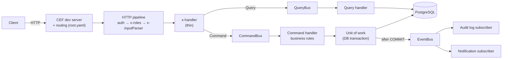
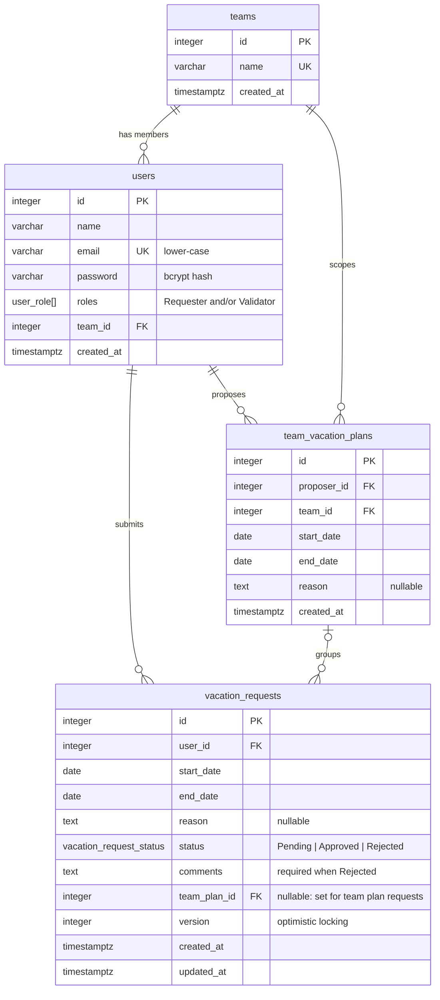

# Vacation Management

A vacation management tool. **Requesters** submit vacation requests; **Validators** (managers) review, approve or
reject them. Teams can look at a shared calendar and plan a vacation together.

- **Backend** (repository root): **Node.js + TypeScript**, the **Common Event Framework (CEF)**, **TypeORM** and
  **PostgreSQL**, with a command/event-oriented architecture.
- **Front-end** ([`frontend/`](frontend/)): a single-page app in **Vue 3 + TypeScript**, **Vue Router**, **Axios** and
  **Tailwind CSS**.

**In a hurry?** Install Node.js and PostgreSQL, then:

```bash
npm install && npm run frontend:install
cp .env.example .env          # then set DB_PASSWORD in .env (PowerShell: Copy-Item .env.example .env)
npm run db:setup
npm run dev:all               # open http://localhost:5173 and log in with a demo button
```

## Contents

1. [Installation](#1-installation)
2. [Database setup](#2-database-setup)
3. [Running the application](#3-running-the-application)
4. [Demo users](#4-demo-users)
5. [API reference](#5-api-reference)
6. [Architecture](#6-architecture)
7. [Business rules](#7-business-rules)
8. [Concurrency](#8-concurrency-many-users-writing-at-the-same-time)
9. [Database design](#9-database-design)
10. [Front-end](#10-front-end)
11. [Testing](#11-testing)
12. [Postman collection](#12-postman-collection)
13. [Technical decisions](#13-technical-decisions)
14. [Assumptions](#14-assumptions)
15. [Known limitations](#15-known-limitations)
16. [Future improvements](#16-future-improvements)

---

## 1. Installation

### Prerequisites

| Tool       | Version                       | Notes                                                                    |
| ---------- | ----------------------------- | ------------------------------------------------------------------------ |
| Node.js    | 20 or later (developed on 24) | Includes npm                                                             |
| PostgreSQL | 14 or later (developed on 18) | Must include the `btree_gist` extension (bundled with standard installs) |
| Docker     | Optional                      | Only if you prefer running PostgreSQL in a container (see below)         |

### Steps

1. **Install the dependencies** of the backend (repository root) and of the front-end (`frontend/`):

   ```bash
   npm install
   npm run frontend:install
   ```

2. **Create the configuration file** from the example:

   ```bash
   cp .env.example .env            # PowerShell: Copy-Item .env.example .env
   ```

3. **Edit `.env`** and set at least `DB_PASSWORD` to the password of your PostgreSQL `postgres` user (and `DB_PORT` if
   PostgreSQL does not listen on 5432). The other values have working defaults for local development.

4. Continue with the [database setup](#2-database-setup).

### Configuration reference (`.env`)

| Variable                 | Default            | Purpose                                             |
| ------------------------ | ------------------ | --------------------------------------------------- |
| `DB_HOST`, `DB_PORT`     | `localhost`, 5432  | PostgreSQL server                                   |
| `DB_USER`, `DB_PASSWORD` | `postgres`, —      | Credentials (`DB_PASSWORD` is required)             |
| `DB_NAME`                | `vacation_db`      | Application database                                |
| `DB_NAME_TEST`           | `vacation_db_test` | Integration-test database (wiped on every test run) |
| `DB_POOL_SIZE`           | 10                 | Connection pool size                                |
| `DB_LOG_QUERIES`         | `false`            | Log every SQL query (debugging)                     |
| `JWT_SECRET`             | —                  | HMAC secret for access tokens (min. 32 characters)  |
| `JWT_EXPIRES_IN`         | `8h`               | Token lifetime (`30m`, `8h`, `1d`, ...)             |
| `APP_TIMEZONE`           | `Asia/Jerusalem`   | Timezone that defines "today" for the date rules    |
| `LOG_LEVEL`              | `info`             | `debug`, `info`, `warn`, `error` or `silent`        |

The configuration is validated at startup: a missing or invalid value stops the application with a message naming
the variable. `.env` is git-ignored; never commit real secrets.

<details>
<summary>Optional: PostgreSQL with Docker instead of a local installation</summary>

```bash
docker compose up -d     # PostgreSQL 18 on port 5433 (avoids clashing with a local install on 5432)
```

Then set `DB_PORT=5433` and `DB_PASSWORD=postgres` in `.env` and continue with the database setup.

</details>

---

## 2. Database setup

One command prepares everything:

```bash
npm run db:setup
```

It runs three steps, which can also be run on their own:

| Step                 | What it does                                                                                                       |
| -------------------- | ------------------------------------------------------------------------------------------------------------------ |
| `npm run db:create`  | Creates the application database (`vacation_db`) and the integration-test database (`vacation_db_test`) if missing |
| `npm run db:migrate` | Applies pending migrations to the application database (safe to run repeatedly)                                    |
| `npm run db:seed`    | Replaces all data with the demo data set: 3 teams, 15 users, 20 vacation requests, 1 team plan                     |

Other database commands:

| Command            | When to use it                                                                   |
| ------------------ | -------------------------------------------------------------------------------- |
| `npm run db:seed`  | Reset the data to the demo set at any time (e.g. after many Postman runs)        |
| `npm run db:reset` | Drop every table, re-run all migrations and re-seed (start completely from zero) |

**Migrations** (in `src/infrastructure/database/migrations/`, hand-written SQL):

1. `InitialSchema`: enum types, `teams`, `users`, `vacation_requests`, the `btree_gist` extension, and the constraints
   and indexes that enforce the business rules.
2. `TeamVacationPlans`: the `team_vacation_plans` table and the link from each request to its plan.

The **test database** is managed by the integration tests themselves: they rebuild its schema from the migrations on
every run, so it never needs manual setup beyond `db:create`.

**Troubleshooting:**

| Error                                        | Fix                                                                                 |
| -------------------------------------------- | ----------------------------------------------------------------------------------- |
| `password authentication failed`             | Check `DB_USER` / `DB_PASSWORD` in `.env`                                           |
| `ECONNREFUSED`                               | PostgreSQL is not running or uses another port: start the service, or set `DB_PORT` |
| `Invalid configuration (check your .env...)` | A required variable is missing or invalid; the message names it                     |
| `extension "btree_gist" is not available`    | Install PostgreSQL's contrib package (e.g. `postgresql-contrib` on Linux)           |

---

## 3. Running the application

### Development (recommended)

```bash
npm run dev:all
```

This starts both parts in one terminal, with automatic reload on code changes:

| URL                           | What                                                                 |
| ----------------------------- | -------------------------------------------------------------------- |
| **http://localhost:5173**     | The application (Vue front-end)                                      |
| **http://localhost:8888**     | The API (CEF local server)                                           |
| **http://localhost:8888/doc** | Interactive API documentation, generated by CEF from `src/root.yaml` |

Press **Ctrl+C** to stop both.

**Logging in:** every demo user has the password **`Password123!`** (for example `noa.levi@example.com`). The login
page also has one-click buttons for a Requester, a Validator and a user with both roles; see
[Demo users](#4-demo-users) for the full list.

### Running the parts separately

```bash
npm run dev                  # API only, on http://localhost:8888
npm run dev --prefix frontend   # front-end only, on http://localhost:5173 (expects the API on port 8888)
```

The front-end calls the API through Vite's proxy (`/api` → `http://localhost:8888`), so it needs the API running.

### Compiled build

```bash
npm run build && npm start             # API: compiles to dist/ with tsc and runs it
npm run build --prefix frontend        # front-end: type-checks and builds static files into frontend/dist/
```

### All scripts

| Script (repository root)   | What it does                                                             |
| -------------------------- | ------------------------------------------------------------------------ |
| `npm run dev:all`          | Starts the API and the front-end together                                |
| `npm run dev`              | Regenerates the CEF handler registry and starts the API with auto-reload |
| `npm run build` / `start`  | Compiles the API to `dist/` / runs the compiled API                      |
| `npm run frontend:install` | Installs the front-end dependencies                                      |
| `npm run db:*`             | Database commands (see [Database setup](#2-database-setup))              |
| `npm test`                 | Unit tests (no database needed)                                          |
| `npm run test:integration` | Integration and concurrency tests against `vacation_db_test`             |
| `npm run test:all`         | Both test suites                                                         |
| `npm run lint` / `format`  | ESLint / Prettier                                                        |
| `npm run typecheck`        | TypeScript type check (`src` and `tests`)                                |
| `npm run codegen`          | Regenerates `src/generated/HandlerRegistry.ts` from `src/root.yaml`      |

Front-end scripts are listed in the [Front-end](#10-front-end) section.

---

## 4. Demo users

All demo users share the password **`Password123!`**. Ids are stable (the seed resets identity counters).

| Id  | Name            | Email                         | Roles                     | Team         |
| --- | --------------- | ----------------------------- | ------------------------- | ------------ |
| 1   | Noa Levi        | `noa.levi@example.com`        | Requester                 | Engineering  |
| 2   | Daniel Cohen    | `daniel.cohen@example.com`    | Requester                 | Engineering  |
| 3   | Maya Friedman   | `maya.friedman@example.com`   | Requester                 | Engineering  |
| 4   | Liam Katz       | `liam.katz@example.com`       | Requester                 | Engineering  |
| 5   | Sarah Mizrahi   | `sarah.mizrahi@example.com`   | Validator                 | Engineering  |
| 6   | David Ben-Ami   | `david.benami@example.com`    | Requester **+** Validator | Engineering  |
| 7   | Yael Shapiro    | `yael.shapiro@example.com`    | Requester                 | Reservations |
| 8   | Omer Peretz     | `omer.peretz@example.com`     | Requester                 | Reservations |
| 9   | Tamar Biton     | `tamar.biton@example.com`     | Requester                 | Reservations |
| 10  | Michael Azoulay | `michael.azoulay@example.com` | Validator                 | Reservations |
| 11  | Ruth Avraham    | `ruth.avraham@example.com`    | Requester **+** Validator | Reservations |
| 12  | Itai Golan      | `itai.golan@example.com`      | Requester                 | Marketing    |
| 13  | Shira Dahan     | `shira.dahan@example.com`     | Requester                 | Marketing    |
| 14  | Eitan Rosen     | `eitan.rosen@example.com`     | Requester                 | Marketing    |
| 15  | Hila Barak      | `hila.barak@example.com`      | Validator                 | Marketing    |

That is 10 Requesters, 3 Validators and 2 users with both roles. The seed also creates 20 vacation requests in every
status (past approved trips, upcoming pending requests, rejections with comments), including one team vacation plan
(proposed by Yael for Omer and Tamar, already decided). Dates are relative to the day you run the seed.

---

## 5. API reference

The full, interactive reference is served at **`GET /doc`** (raw OpenAPI at `GET /doc/spec`).

### Endpoints

| Method & path                         | Who                      | Purpose                                                          | Success |
| ------------------------------------- | ------------------------ | ---------------------------------------------------------------- | ------- |
| `POST /auth/login`                    | Public                   | Log in; returns a JWT and the user profile                       | 200     |
| `GET /auth/me`                        | Logged in                | Current user, roles and team                                     | 200     |
| `POST /vacation-requests`             | Requester                | Submit a request (`startDate`, `endDate`, optional `reason`)     | 201     |
| `GET /me/vacation-requests`           | Requester                | My requests (paginated; filter by `status`)                      | 200     |
| `GET /vacation-requests/:id`          | Owner or Validator       | One request with all fields                                      | 200     |
| `PATCH /vacation-requests/:id`        | Owner                    | Change dates/reason of a **Pending** request (send `version`)    | 200     |
| `DELETE /vacation-requests/:id`       | Owner                    | Cancel a **Pending** request                                     | 204     |
| `GET /vacation-requests`              | Validator                | All requests: filters, sorting, pagination (dashboard)           | 200     |
| `PATCH /vacation-requests/:id/status` | Validator                | `{"status":"Approved"}` or `{"status":"Rejected","comments":…}`  | 200     |
| `GET /users`                          | Validator                | User directory for the "filter by user" dropdown                 | 200     |
| `GET /me/team/members`                | Logged in                | My team and its members                                          | 200     |
| `GET /me/team/vacations`              | Logged in                | Team calendar (`from`, `to`)                                     | 200     |
| `POST /me/team/vacation-plans`        | Requester                | Plan a team vacation for me + teammates, all or nothing          | 201     |
| `GET /me/team/vacation-plans`         | Requester                | Plans I proposed or take part in, with each participant's status | 200     |
| `GET /me/team/vacation-plans/:id`     | Plan member or Validator | One team plan with each participant's status                     | 200     |

**Authentication:** `POST /auth/login` with `{ "email", "password" }`, then send
`Authorization: Bearer <accessToken>` on every other request.

**List parameters:** `page` (default 1), `limit` (default 20, max 100), `sortBy` (`createdAt` | `startDate` |
`endDate`), `sortOrder` (`asc` | `desc`). The validator list also accepts `status`, `userId`, `teamId`,
`startDate` (requests starting on or after) and `endDate` (requests ending on or before); filters can be combined.

```jsonc
// Paginated response
{
  "data": [/* items */],
  "pagination": { "page": 1, "limit": 20, "totalItems": 42, "totalPages": 3 },
}
```

### Status codes and errors

Every error has the same shape. Clients should branch on `code`, not on `message`:

```json
{
  "error": {
    "code": "VACATION_OVERLAP",
    "message": "These dates overlap with ...",
    "details": { "conflictingRequestId": 12 }
  }
}
```

| Status | Meaning                                        | Codes                                                                                                                                                         |
| ------ | ---------------------------------------------- | ------------------------------------------------------------------------------------------------------------------------------------------------------------- |
| 400    | Invalid input                                  | `VALIDATION_ERROR`, `INVALID_JSON`, `READ_ONLY_FIELD`, `INVALID_DATE_RANGE`, `START_DATE_NOT_IN_FUTURE`, `REJECTION_COMMENT_REQUIRED`, `INVALID_PARTICIPANTS` |
| 401    | Not authenticated (`WWW-Authenticate: Bearer`) | `AUTHENTICATION_REQUIRED`, `INVALID_TOKEN`, `TOKEN_EXPIRED`, `INVALID_CREDENTIALS`                                                                            |
| 403    | Authenticated but not allowed                  | `FORBIDDEN` (missing role), `SELF_DECISION_FORBIDDEN`                                                                                                         |
| 404    | Not found, **or not yours**                    | `ROUTE_NOT_FOUND`, `VACATION_REQUEST_NOT_FOUND`, `TEAM_PLAN_NOT_FOUND`                                                                                        |
| 405    | Wrong method for the path (`Allow` header)     | `METHOD_NOT_ALLOWED`                                                                                                                                          |
| 409    | Conflicts with the current data                | `VACATION_OVERLAP`, `DUPLICATE_VACATION_REQUEST`, `REQUEST_NOT_PENDING`, `VERSION_CONFLICT`, `TEAM_PLAN_CONFLICT`, `CONCURRENT_MODIFICATION`                  |
| 500    | Unexpected error (details are only logged)     | `INTERNAL_ERROR`                                                                                                                                              |

A requester asking for someone else's request gets `404`, not `403`, so ids of other people's requests cannot be
discovered.

---

## 6. Architecture

### Layers and request flow



1. **CEF** turns the incoming request into a `CommonEvent` and finds the route in `src/root.yaml`.
2. The **pipeline** (`src/http/pipeline.ts`) enforces the route's security, read from the same YAML: standard
   OpenAPI `security` (public or bearer token) plus an `x-roles` list → 401 / 403. Authentication runs **before**
   input parsing.
3. The route's **`x-inputParser`** validates the input with a zod schema → 400.
4. The route's **`x-handler`** builds a **command** (writes) or **query** (reads) and dispatches it on a bus.
5. **Command handlers** apply business rules inside a **unit of work** (one DB transaction) and _raise_ domain
   events. Events are **published only after the transaction commits**.
6. **Event subscribers** react without the command handlers knowing about them (audit log, simulated notifications).
7. Any error becomes the standard error response; unexpected errors are logged and hidden behind a 500.

### Commands, queries and events

| Commands (write)                | Queries (read)                | Domain events                   |
| ------------------------------- | ----------------------------- | ------------------------------- |
| `LoginCommand`                  | `GetCurrentUserQuery`         | `UserLoggedInEvent`             |
| `CreateVacationRequestCommand`  | `GetVacationRequestQuery`     | `VacationRequestCreatedEvent`   |
| `UpdateVacationRequestCommand`  | `ListMyVacationRequestsQuery` | `VacationRequestUpdatedEvent`   |
| `CancelVacationRequestCommand`  | `ListVacationRequestsQuery`   | `VacationRequestCancelledEvent` |
| `ApproveVacationRequestCommand` | `ListUsersQuery`              | `VacationRequestApprovedEvent`  |
| `RejectVacationRequestCommand`  | `GetTeamMembersQuery`         | `VacationRequestRejectedEvent`  |
| `PlanTeamVacationCommand`       | `GetTeamCalendarQuery`        | `TeamVacationPlannedEvent`      |
|                                 | `ListMyTeamPlansQuery`        |                                 |
|                                 | `GetTeamPlanQuery`            |                                 |

Each command/query file contains the message class and its handler. All handlers are registered in one place, the
composition root (`src/bootstrap/container.ts`).

### Project structure

```
src/
├── index.ts                    # Entry point: CEF Lambda-style handler + local dev server (--local)
├── root.yaml                   # Routes, security (x-roles) and OpenAPI docs, read by CEF
├── generated/                  # HandlerRegistry.ts, generated by `cef-gen-handlers` from root.yaml
├── bootstrap/container.ts      # Composition root: wires buses, handlers, subscribers, DB
├── config/config.ts            # Typed, validated environment configuration
├── http/                       # HTTP edge: pipeline, auth, access policy, parsing, responses, errors
├── shared/                     # Framework-agnostic building blocks
│   ├── cqrs/                   #   Command/Query buses, DomainEvent, EventBus
│   ├── errors/                 #   AppError hierarchy + error codes
│   ├── persistence/            #   UnitOfWork + Repositories contracts, pagination
│   ├── time/                   #   Calendar-date helpers, Clock
│   └── logging/                #   Structured JSON logger
├── infrastructure/database/    # TypeORM DataSource, unit of work, migrations, seed, db:* scripts
└── modules/                    # One folder per feature
    ├── auth/                   #   login, JWT, bcrypt
    ├── users/                  #   User entity, user directory
    ├── teams/                  #   Team and TeamVacationPlan entities, team calendar, team plans
    ├── vacation-requests/      #   VacationRequest entity, rules, commands, queries, events
    └── notifications/          #   Event subscribers (audit log, simulated notifications)
frontend/                       # Vue single-page app (see the Front-end section)
tests/                          # unit/ (no database) and integration/ (real PostgreSQL)
postman/                        # Postman collection + environment
```

Inside a module: `domain/` (entities, rules, repository interfaces), `application/` (commands, queries, DTOs),
`events/`, `infrastructure/` (TypeORM repositories) and `http/` (schemas and thin handlers). Dependencies point
inwards: the domain knows nothing about HTTP or TypeORM queries.

---

## 7. Business rules

| #   | Rule                                                           | Where it is enforced                                                            | Error                                   |
| --- | -------------------------------------------------------------- | ------------------------------------------------------------------------------- | --------------------------------------- |
| 1   | End date on or after start date (1-day vacations OK)           | `vacationRequestRules.ts` + DB `CHECK`                                          | 400 `INVALID_DATE_RANGE`                |
| 2   | A user's requests may not overlap                              | `vacationRequestRules.ts` + DB `EXCLUDE` constraint (Pending/Approved only)     | 409 `VACATION_OVERLAP`                  |
| 3   | The exact same dates cannot be requested twice                 | `vacationRequestRules.ts` + DB `UNIQUE (user_id, start_date, end_date)`         | 409 `DUPLICATE_VACATION_REQUEST`        |
| 4   | Approved (and Rejected) requests cannot be modified            | `VacationRequest.assertPending()`                                               | 409 `REQUEST_NOT_PENDING`               |
| 5   | No past dates; cannot start on the submission day              | `vacationRequestRules.ts` (with an injectable `Clock`)                          | 400 `START_DATE_NOT_IN_FUTURE`          |
| 6   | A rejection must carry a comment                               | `VacationRequest.reject()` + DB `CHECK`                                         | 400 `REJECTION_COMMENT_REQUIRED`        |
| 7   | Only validators approve/reject; requesters cannot set `status` | `x-roles: [Validator]` on the status route + read-only fields in request bodies | 403 `FORBIDDEN` / 400 `READ_ONLY_FIELD` |
| 8   | Requesters see every field of their own requests               | Owner/validator access check in `GetVacationRequestQuery`                       | 404 for anyone else                     |
| +   | Nobody decides on their own request (dual-role users)          | `VacationRequest.approve()` / `reject()`                                        | 403 `SELF_DECISION_FORBIDDEN`           |

Every rule is checked again when a Pending request is updated.

---

## 8. Concurrency: many users writing at the same time

Node.js runs requests concurrently on one event loop, and each command runs in its own PostgreSQL transaction on
its own pooled connection. So two requests _can_ both pass an application-level check before either one writes.
The design never relies on application checks alone:

| Race                                                         | Protection                                                                                                                  | Loser gets                      |
| ------------------------------------------------------------ | --------------------------------------------------------------------------------------------------------------------------- | ------------------------------- |
| Same user submits overlapping requests in parallel           | `EXCLUDE USING gist (user_id WITH =, daterange(start_date, end_date, '[]') WITH &&) WHERE status IN ('Pending','Approved')` | 409 `VACATION_OVERLAP`          |
| Same exact dates submitted in parallel                       | `UNIQUE (user_id, start_date, end_date)`                                                                                    | 409 `DUPLICATE_…` / `…_OVERLAP` |
| Two validators decide the same request at once               | `SELECT … FOR UPDATE` row lock; the second waits, then sees it is no longer Pending                                         | 409 `REQUEST_NOT_PENDING`       |
| Edit based on a stale copy (two tabs, or validator vs. edit) | Optimistic locking: `version` column (TypeORM `@VersionColumn`) must match what the client sends                            | 409 `VERSION_CONFLICT`          |
| Two team plans competing for the same people                 | One transaction per plan (all or nothing); inserts in ascending user-id order so plans cannot deadlock                      | 409, nothing half-created       |
| Deadlock / serialization failure (safety net)                | Translated to a retryable error                                                                                             | 409 `CONCURRENT_MODIFICATION`   |

Constraint violations are translated into the same domain errors the application checks produce
(`src/infrastructure/database/databaseErrors.ts`), so clients see one consistent behaviour. Events are published only
after commit, so a request that lost a race never triggers notifications.

All of this is verified by `tests/integration/concurrency.test.ts`, which fires parallel requests through the real
stack: for example, 10 identical submissions at once → exactly one `201` and nine `409`.

---

## 9. Database design



**Changes to the original schema** (all agreed during design):

- `teams` table and `users.team_id`: needed for team calendars and team vacation plans.
- `users.role` → `users.roles` (a `user_role[]` enum array, never empty): a user can be both Requester and Validator.
- `vacation_requests.version`: optimistic locking.
- `team_vacation_plans` table and `vacation_requests.team_plan_id`: a team plan is stored and each participant's
  request points to it, so everyone involved can follow how the plan was decided.
- Constraints enforcing rules 1, 2, 3 and 6 at the database level (see above).
- `users.password` stores a **bcrypt hash**, never the password itself, and is excluded from every query except login.

**Indexes:**

| Index                                          | Serves                                                                 |
| ---------------------------------------------- | ---------------------------------------------------------------------- |
| `vacation_requests_no_overlap` (GiST)          | Overlap checks (the app queries with the same `daterange &&` operator) |
| `vacation_requests_user_dates_unique` (B-tree) | Per-user lookups: "my requests", duplicate checks                      |
| `vacation_requests_status_start_date_idx`      | Dashboard filtered by status and/or dates, team calendar               |
| `vacation_requests_created_at_idx`             | Dashboard default sort (newest first)                                  |
| `users_team_id_idx`                            | Team members, team calendar join                                       |
| `vacation_requests_team_plan_id_idx` (partial) | Requests of given plans (only rows with a plan are indexed)            |
| `team_vacation_plans_proposer_id_idx`          | "My team plans" (plans I proposed)                                     |

**Pagination** uses `LIMIT/OFFSET` plus a `COUNT`, with a deterministic order (sort column, then `id`). Listing
joins are many-to-one only (request → user → team, request → plan → proposer), so rows are never multiplied and no
N+1 queries occur.

**Dates** are PostgreSQL `date` columns (no time, no timezone) and travel through the code as `YYYY-MM-DD` strings;
the `pg` driver is configured not to convert them into JavaScript `Date` objects.

---

## 10. Front-end

A single-page app in [`frontend/`](frontend/) with its own `package.json`. It runs on **http://localhost:5173**
(`npm run dev:all` from the root, or `npm run dev` inside `frontend/`).

### Screens

One combined interface: the menu shows what the user's roles allow; users with both roles see everything.

| Screen             | Path             | Who       | What it does                                                                                                                    |
| ------------------ | ---------------- | --------- | ------------------------------------------------------------------------------------------------------------------------------- |
| Login              | `/login`         | Everyone  | Log in; one-click demo accounts (password `Password123!`)                                                                       |
| New request        | `/requests/new`  | Requester | Submit a vacation (dates start tomorrow at the earliest); home of requesters                                                    |
| My requests        | `/requests`      | Requester | All my requests with every field; filter by status; edit or cancel Pending ones                                                 |
| Dashboard          | `/dashboard`     | Validator | All requests; filter by status, team, employee, dates; sort; approve or reject (comment required); home of validator-only users |
| Team calendar      | `/team/calendar` | Both      | Pending and approved vacations of my team, grouped by month                                                                     |
| Plan team vacation | `/team/plan`     | Requester | Pick dates and teammates (one Pending request each, all or nothing); follow every plan I am part of, with each person's status  |

### Structure

```
frontend/src/
├── main.ts, App.vue          # App bootstrap; login renders alone, other pages inside AppLayout
├── router/index.ts           # Routes + guard (login required, role checks via route meta)
├── api/                      # http.ts (one Axios instance) + one module per backend area
├── composables/              # useAuth (session), usePaginatedList, useAsyncAction
├── components/
│   ├── base/                 # Reusable UI: BaseButton, BaseInput, BaseSelect, BaseTextarea, BaseCard,
│   │                         #   BaseModal, AlertMessage, StatusBadge, DataTable, PaginationBar, ...
│   ├── layout/               # AppLayout (top bar, role-based menu) + navigation config
│   └── vacation/             # VacationRequestForm, VacationPeriod, DecisionModal, TeamPlanCard, TeamPlanTag
├── views/                    # One component per screen; they mostly compose the pieces above
├── types/api.ts              # TypeScript types of the API payloads
└── utils/dates.ts            # Calendar-day helpers (YYYY-MM-DD)
```

### How it talks to the API

- All calls go through `frontend/src/api/http.ts`. It adds the bearer token, turns API errors into `ApiError` (the API's
  message is shown to the user as-is), and on `401` ends the session and returns to the login page.
- Vite proxies `/api/*` to the backend, so the browser sees a single origin. Set `VITE_API_TARGET` to point the proxy
  elsewhere.
- The session (token, user, expiry) is kept in `localStorage`, so refreshing the page keeps you logged in.
- Updates and decisions send the request's `version`; if someone changed it meanwhile, the error is shown and the
  list reloads.
- The router guard mirrors the API's role rules for a consistent UI; the API remains the source of truth.

### Front-end scripts (inside `frontend/`)

| Script              | What it does                               |
| ------------------- | ------------------------------------------ |
| `npm run dev`       | Starts the website with hot reload         |
| `npm run build`     | Type-checks (`vue-tsc`) and builds `dist/` |
| `npm run typecheck` | Type-checks `.ts` and `.vue` files         |
| `npm run lint`      | ESLint (TypeScript + Vue rules)            |

---

## 11. Testing

```bash
npm test                   # unit tests: domain rules, entity, command handlers, buses, HTTP layer
npm run test:integration   # full stack against PostgreSQL: API flows + concurrency scenarios
npm run test:all           # both
```

- **Unit tests** (`tests/unit`) need no database. Command handlers run against in-memory repositories and a fake
  unit of work. "Today" is controlled with a `FixedClock`. They also contain contract tests for `root.yaml`: every
  route has a real handler, only login is public, and every other route except `GET /auth/me` declares its roles.
- **Integration tests** (`tests/integration`) call the real entry point (`src/index.ts` → CEF → pipeline →
  PostgreSQL), exactly like the dev server does. They use the separate `vacation_db_test` database, which is
  created if needed and rebuilt from migrations on every run; the demo data is re-seeded before each test.
- **Concurrency tests** (`tests/integration/concurrency.test.ts`) fire parallel requests (identical submissions,
  overlapping submissions, two validators deciding at once, competing team plans, cancel vs. approve) and check that
  exactly one wins and that no data is half-written.

---

## 12. Postman collection

Files in [`postman/`](postman/):

- `VacationManagement.postman_collection.json`: 43 requests in 5 folders: Authentication, Requester, Validator,
  Team planning, and **Error cases**, where every business rule is deliberately broken.
- `VacationManagement.local.postman_environment.json`: `baseUrl` and the demo credentials.

1. Start the API (`npm run dev`) and reset the data (`npm run db:seed`).
2. In Postman: **Import** both files and select the _Vacation Management - Local_ environment.
3. Run the whole collection with the **Collection Runner**, or send requests one by one starting with the
   Authentication folder.

Login requests save the tokens; create requests save the new ids and versions; every request has test assertions.
Each run picks a random far-future date window, so the collection can be run repeatedly without collisions (run
`npm run db:seed` to clean up afterwards).

---

## 13. Technical decisions

### Architecture

- **Command/query separation with an in-process bus.** Every write is a command (`ApproveVacationRequestCommand`, ...)
  with exactly one handler; every read is a query. HTTP handlers only translate HTTP into messages, so business logic
  never depends on the transport and could be reused from a queue consumer or a CLI.
- **Domain events published after commit.** Command handlers _raise_ events inside the unit of work; the event bus
  publishes them only once the transaction has committed. Subscribers (audit log, notifications) can never act on a
  change that was rolled back, and a failing subscriber never fails the user's request.
- **CEF for routing, not for the CQRS bus.** CEF normalizes events and routes them to handlers declared in an OpenAPI
  file; it does not provide commands or events. The buses are small, explicit implementations in `src/shared/cqrs`.
- **One file declares routes, docs and security.** CEF only passes `x-handler` / `x-inputParser` on to the route
  config, so the pipeline reads `security` and `x-roles` from the parsed OpenAPI document (`getSpec()`). Routes,
  documentation and access rules cannot drift apart, and a contract test checks every route.
- **Modules per feature, layers inside each module.** `auth`, `users`, `teams`, `vacation-requests` and
  `notifications` each contain their own domain, application, infrastructure and HTTP code. Dependencies point inwards
  (HTTP → application → domain), and repositories are interfaces, so the domain stays free of HTTP and SQL.
- **A single composition root** (`src/bootstrap/container.ts`) creates and wires everything; nothing else creates
  infrastructure, which keeps dependencies visible and tests easy to set up.

### Code

- **TypeScript everywhere, strict mode**, in both the backend and the front-end.
- **Business rules as pure functions and entity methods** (`vacationRequestRules.ts`, `VacationRequest.approve()`),
  so they are unit-tested without a database and give precise error codes.
- **An injectable `Clock`** decides what "today" is, so date rules are deterministic in tests.
- **zod schemas with strict objects** validate every input; unknown or read-only fields are rejected instead of being
  silently ignored.
- **One error hierarchy** (`AppError` and subclasses) mapped to HTTP status codes in a single place; every error
  response has the same shape and a machine-readable `code`.
- **TypeORM entities double as domain objects** (they carry behaviour such as `approve` and `reschedule`), avoiding a
  parallel set of persistence models.
- **Explicit column types on every entity**, because CEF's bundler (esbuild) cannot emit decorator metadata. The same
  code runs under `tsc`, `tsx`, `ts-jest` and esbuild.
- **Consistent style enforced by tools:** ESLint and Prettier for the backend and front-end, and a short description
  comment at the top of every source file.

### Database

- **Constraints as the last line of defence.** The exclusion constraint, unique dates and `CHECK`s enforce the rules
  even when two requests race; their violations are translated back into the normal domain errors.
- **Pessimistic + optimistic locking.** Row locks (`SELECT ... FOR UPDATE`) serialize writers on the same request;
  the `version` column rejects edits and decisions based on stale data.
- **Hand-written migrations, `synchronize` off.** Exclusion constraints, partial indexes and enum arrays are clearer in
  SQL, and the schema only ever changes through reviewed migrations.
- **Dates as `date` columns and `YYYY-MM-DD` strings** end to end, which rules out timezone shifts of vacation days.

### Security

- **Stateless JWT (HS256)** carrying id, roles and team; only the HS256 algorithm and the expected issuer are
  accepted. Passwords are hashed with bcrypt (`bcryptjs`, pure JavaScript, so no native build on Windows).
- **Deny by default:** a route without explicit `security` requires authentication; role checks run before input
  parsing; other users' resources answer `404` so ids cannot be probed.
- **Uniform login errors:** an unknown email and a wrong password return the same error in about the same time.

### Front-end

- **Vue 3 Composition API with `<script setup>` and TypeScript**; screens are thin and built from reusable base
  components (`BaseButton`, `DataTable`, `BaseModal`, ...) and composables (`useAuth`, `usePaginatedList`,
  `useAsyncAction`) instead of repeated code.
- **One Axios client** handles tokens, error normalization and session expiry for every call.
- **Vite dev proxy** (`/api` → API) gives the browser a single origin, which avoids the CORS limitations of CEF's dev
  server.
- **No state-management library:** the only global state is the session, held in one small composable; everything
  else is local to its screen.
- **Tailwind's blue palette** with white text, and amber / green / red reserved for request statuses.

### Tooling

- **`tsx` for development, `tsc` for builds, `ts-jest` for tests.** Lambda deployment is out of scope, so `cef-build`
  (esbuild bundling + zip for Lambda) is not used; `npm run build` compiles with `tsc` and copies `root.yaml` next to
  the compiled entry point, where CEF looks for it.
- **Two test levels:** fast unit tests without a database, and integration tests that exercise the real stack and
  real PostgreSQL concurrency on a dedicated database.

---

## 14. Assumptions

- **Vacations are whole days.** Dates are `YYYY-MM-DD` with no time component; anything else (e.g.
  `2026-12-01T09:00:00Z`) is rejected. A one-day vacation has `startDate == endDate`.
- **"Today" is defined in one timezone** (`APP_TIMEZONE`, default `Asia/Jerusalem`). A vacation must start
  **tomorrow or later**; requesting a vacation that starts today is refused.
- **Only Pending requests can change.** Requesters may edit or cancel (delete) Pending requests; Approved and
  Rejected requests are final, and validators can only decide on Pending requests.
- **Overlaps** are checked against the user's Pending and Approved requests; Rejected requests do not block new
  dates, but the _exact same_ dates can never be requested twice, whatever the status.
- **Validators see and decide on every team's requests**; teams only scope the team calendar and team plans.
- **Validators may decide on requests whose dates have already passed** (e.g. a late approval).
- **Team plans:** only users with the Requester role can propose; the proposer is always included; participants
  must be teammates with the Requester role. Each participant's request is a normal Pending request, approved or
  rejected individually by validators (a plan can end up partly approved), and each participant can cancel their
  own. The proposer and every participant see the plan with each person's status; validator comments are only shown
  to the person they concern and to validators.
- **The team calendar** shows names, dates and status only (no reasons or comments), for a window of up to 366
  days (default: today + 90 days).
- **No sign-up endpoint:** users come from the seed.

---

## 15. Known limitations

**Functional**

- **No vacation balance or allowance**: users can request any number of days; weekends and public holidays are
  counted like any other day.
- **No user management:** users, roles and teams only come from the seed (no sign-up, profile or admin screens).
- **Decisions are not attributed in the database:** who approved or rejected a request is recorded in the event log
  only (there is no `decided_by` column), and decided requests have no history of earlier versions.
- **A participant who cancels their part of a team plan disappears from the plan view**, because cancelling deletes
  the request. Team plans created before the team-plan migration are not linked to their requests.
- **Notifications are simulated:** events are written to the log; nobody actually receives an email or message.

**Technical**

- **CEF's local server and browsers:** it answers CORS preflight requests itself, without allowing `PATCH` or the
  `Authorization` header. The front-end works around this with Vite's proxy; a production deployment needs a single
  origin or CORS configured in front of the API.
- **No refresh tokens or token revocation:** a token stays valid until it expires (8 hours by default), and role
  changes apply on the next login. The session token is stored in `localStorage`.
- **No rate limiting** on the login endpoint.
- **Offset pagination** is simple and fine at this scale, but slows down on very deep pages of very large tables.
- **"Today" can differ between the browser and the API** around midnight when they are in different timezones; the
  API decides, and its error message is shown.
- **No front-end tests yet.**
- **CEF built-in routes** (`/doc`, `/context`, `/dependencies`) are public, which is fine locally but should be
  restricted elsewhere.
- **`npm audit` warnings** come from CEF's own dependencies (e.g. `adm-zip`, an older `esbuild`) and cannot be fixed
  from this project.

---

## 16. Future improvements

**Product features**

- **Vacation balances:** yearly allowance per user, with the remaining days shown in the request form and checked by
  the API; working-day counting that skips weekends and public holidays.
- **Decision audit trail:** `decided_by` / `decided_at` columns and a request history, shown to requesters and
  validators.
- **Real notifications:** email or Slack messages from the existing event subscribers, delivered reliably through an
  outbox table and a queue (CEF already supports SQS as an event source).
- **Richer team planning:** keep cancelled participants visible in a plan, let the proposer cancel a whole plan, and
  optionally let validators decide on a whole plan at once.
- **Team scoping for validators:** let each validator manage only their own teams.
- **User administration:** screens and endpoints to manage users, roles and teams.
- **Calendar views:** a month grid for the team calendar and an export to iCal / Google Calendar.

**Security**

- Short-lived access tokens with refresh tokens in `httpOnly` cookies, and token revocation on logout.
- Rate limiting and lockout on repeated failed logins.
- Restrict or disable CEF's built-in routes outside development.

**Scalability and operations**

- Keyset (cursor) pagination for very large lists.
- Deployment as an AWS Lambda behind API Gateway (the entry point is already a CEF Lambda handler), with secrets in
  AWS Parameter Store, which CEF supports.
- Serve the built front-end and the API from one origin (e.g. CloudFront in front of S3 and API Gateway).
- Request ids in logs, metrics and health checks; CI running lint, type checks and both test suites on every push.

**Quality**

- Front-end component tests (Vitest + Vue Test Utils) and end-to-end tests (Playwright) for the main flows.
- Contract tests checking that `frontend/src/types/api.ts` stays in sync with the OpenAPI document, or generating those
  types from `root.yaml`.
