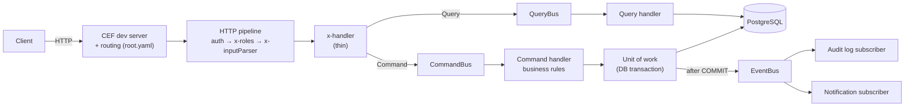
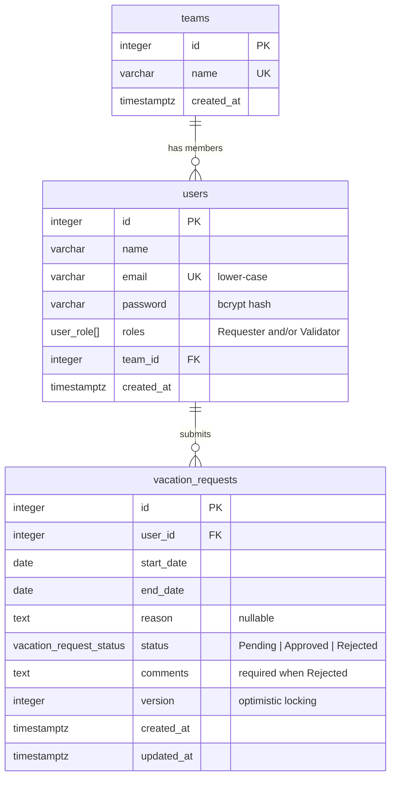

# Vacation Management API

Backend for a vacation management tool. **Requesters** submit vacation requests; **Validators** (managers)
review, approve or reject them. Teams can look at a shared calendar and plan a vacation together.

Built with **Node.js + TypeScript**, the **Common Event Framework (CEF)**, **TypeORM** and **PostgreSQL**, with a
command/event-oriented architecture.

## Contents

1. [Quick start](#1-quick-start)
2. [Demo users](#2-demo-users)
3. [API reference](#3-api-reference)
4. [Architecture](#4-architecture)
5. [Business rules](#5-business-rules)
6. [Concurrency](#6-concurrency-many-users-writing-at-the-same-time)
7. [Database design](#7-database-design)
8. [Testing](#8-testing)
9. [Postman collection](#9-postman-collection)
10. [Technical decisions](#10-technical-decisions)
11. [Assumptions](#11-assumptions)
12. [Known limitations and next steps](#12-known-limitations-and-next-steps)

---

## 1. Quick start

**Prerequisites:** Node.js 20+ (developed on Node 24) and PostgreSQL 14+ (developed on PostgreSQL 18).
Docker is **not** required.

```bash
npm install

# 1. Configure: copy the example file and set DB_PASSWORD to your PostgreSQL password.
cp .env.example .env            # PowerShell: Copy-Item .env.example .env

# 2. Create the databases, apply migrations and load the demo data.
npm run db:setup

# 3. Start the API on http://localhost:8888 (restarts on file changes).
npm run dev
```

Open **http://localhost:8888/doc** for the interactive API documentation (generated by CEF from `src/root.yaml`).

| Script                     | What it does                                                              |
| -------------------------- | ------------------------------------------------------------------------- |
| `npm run dev`              | Regenerates the CEF handler registry and starts the API with auto-reload  |
| `npm run build` / `start`  | Compiles to `dist/` and runs the compiled API                             |
| `npm run db:setup`         | `db:create` + `db:migrate` + `db:seed`                                    |
| `npm run db:seed`          | Resets all data to the demo data set (safe to run any time)               |
| `npm run db:reset`         | Drops all tables, re-runs migrations, re-seeds                            |
| `npm test`                 | Unit tests (no database needed)                                           |
| `npm run test:integration` | Integration and concurrency tests against the `vacation_db_test` database |
| `npm run lint` / `format`  | ESLint / Prettier                                                         |
| `npm run typecheck`        | TypeScript type check (`src` and `tests`)                                 |

<details>
<summary>Optional: PostgreSQL with Docker</summary>

`docker compose up -d` starts PostgreSQL 18 on port **5433**. Set `DB_PORT=5433` and `DB_PASSWORD=postgres` in
`.env`, then run `npm run db:setup`.

</details>

### Configuration (`.env`)

| Variable                 | Default            | Purpose                                             |
| ------------------------ | ------------------ | --------------------------------------------------- |
| `DB_HOST`, `DB_PORT`     | `localhost`, 5432  | PostgreSQL server                                   |
| `DB_USER`, `DB_PASSWORD` | `postgres`, —      | Credentials (`DB_PASSWORD` is required)             |
| `DB_NAME`                | `vacation_db`      | Application database                                |
| `DB_NAME_TEST`           | `vacation_db_test` | Integration-test database (wiped on every test run) |
| `DB_POOL_SIZE`           | 10                 | Connection pool size                                |
| `JWT_SECRET`             | —                  | HMAC secret for access tokens (min. 32 characters)  |
| `JWT_EXPIRES_IN`         | `8h`               | Token lifetime (`30m`, `8h`, `1d`, ...)             |
| `APP_TIMEZONE`           | `Asia/Jerusalem`   | Timezone that defines "today" for the date rules    |
| `LOG_LEVEL`              | `info`             | `debug`, `info`, `warn`, `error` or `silent`        |

The configuration is validated at startup; a missing or invalid value stops the app with a message naming it.

---

## 2. Demo users

All demo users share the password **`Password123!`**. Ids are stable (the seed resets identity counters).

| Id  | Name            | Email                         | Roles                     | Team         |
| --- | --------------- | ----------------------------- | ------------------------- | ------------ |
| 1   | Noa Levi        | `noa.levi@example.com`        | Requester                 | Engineering  |
| 2   | Daniel Cohen    | `daniel.cohen@example.com`    | Requester                 | Engineering  |
| 3   | Maya Friedman   | `maya.friedman@example.com`   | Requester                 | Engineering  |
| 4   | Liam Katz       | `liam.katz@example.com`       | Requester                 | Engineering  |
| 5   | Sarah Mizrahi   | `sarah.mizrahi@example.com`   | Validator                 | Engineering  |
| 6   | David Ben-Ami   | `david.benami@example.com`    | Requester **+** Validator | Engineering  |
| 7   | Yael Shapiro    | `yael.shapiro@example.com`    | Requester                 | Reservations |
| 8   | Omer Peretz     | `omer.peretz@example.com`     | Requester                 | Reservations |
| 9   | Tamar Biton     | `tamar.biton@example.com`     | Requester                 | Reservations |
| 10  | Michael Azoulay | `michael.azoulay@example.com` | Validator                 | Reservations |
| 11  | Ruth Avraham    | `ruth.avraham@example.com`    | Requester **+** Validator | Reservations |
| 12  | Itai Golan      | `itai.golan@example.com`      | Requester                 | Marketing    |
| 13  | Shira Dahan     | `shira.dahan@example.com`     | Requester                 | Marketing    |
| 14  | Eitan Rosen     | `eitan.rosen@example.com`     | Requester                 | Marketing    |
| 15  | Hila Barak      | `hila.barak@example.com`      | Validator                 | Marketing    |

That is 10 Requesters, 3 Validators and 2 users with both roles. The seed also creates 17 vacation requests in
every status (past approved trips, upcoming pending requests, rejections with comments), dated relative to the
day you run it.

---

## 3. API reference

The full, interactive reference is served at **`GET /doc`** (raw OpenAPI at `GET /doc/spec`).

### Endpoints

| Method & path                         | Who                | Purpose                                                         | Success |
| ------------------------------------- | ------------------ | --------------------------------------------------------------- | ------- |
| `POST /auth/login`                    | Public             | Log in; returns a JWT and the user profile                      | 200     |
| `GET /auth/me`                        | Logged in          | Current user, roles and team                                    | 200     |
| `POST /vacation-requests`             | Requester          | Submit a request (`startDate`, `endDate`, optional `reason`)    | 201     |
| `GET /me/vacation-requests`           | Requester          | My requests (paginated; filter by `status`)                     | 200     |
| `GET /vacation-requests/:id`          | Owner or Validator | One request with all fields                                     | 200     |
| `PATCH /vacation-requests/:id`        | Owner              | Change dates/reason of a **Pending** request (send `version`)   | 200     |
| `DELETE /vacation-requests/:id`       | Owner              | Cancel a **Pending** request                                    | 204     |
| `GET /vacation-requests`              | Validator          | All requests: filters, sorting, pagination (dashboard)          | 200     |
| `PATCH /vacation-requests/:id/status` | Validator          | `{"status":"Approved"}` or `{"status":"Rejected","comments":…}` | 200     |
| `GET /users`                          | Validator          | User directory for the "filter by user" dropdown                | 200     |
| `GET /me/team/members`                | Logged in          | My team and its members                                         | 200     |
| `GET /me/team/vacations`              | Logged in          | Team calendar (`from`, `to`)                                    | 200     |
| `POST /me/team/vacation-plans`        | Requester          | Plan a team vacation for me + teammates, all or nothing         | 201     |

**Authentication:** `POST /auth/login` with `{ "email", "password" }`, then send
`Authorization: Bearer <accessToken>` on every other request.

**List parameters:** `page` (default 1), `limit` (default 20, max 100), `sortBy` (`createdAt` | `startDate` |
`endDate`), `sortOrder` (`asc` | `desc`). The validator list also accepts `status`, `userId`, `teamId`,
`startDate` (requests starting on or after) and `endDate` (requests ending on or before); filters can be combined.

```jsonc
// Paginated response
{
  "data": [/* items */],
  "pagination": { "page": 1, "limit": 20, "totalItems": 42, "totalPages": 3 },
}
```

### Status codes and errors

Every error has the same shape. Clients should branch on `code`, not on `message`:

```json
{
  "error": {
    "code": "VACATION_OVERLAP",
    "message": "These dates overlap with ...",
    "details": { "conflictingRequestId": 12 }
  }
}
```

| Status | Meaning                                        | Codes                                                                                                                                                         |
| ------ | ---------------------------------------------- | ------------------------------------------------------------------------------------------------------------------------------------------------------------- |
| 400    | Invalid input                                  | `VALIDATION_ERROR`, `INVALID_JSON`, `READ_ONLY_FIELD`, `INVALID_DATE_RANGE`, `START_DATE_NOT_IN_FUTURE`, `REJECTION_COMMENT_REQUIRED`, `INVALID_PARTICIPANTS` |
| 401    | Not authenticated (`WWW-Authenticate: Bearer`) | `AUTHENTICATION_REQUIRED`, `INVALID_TOKEN`, `TOKEN_EXPIRED`, `INVALID_CREDENTIALS`                                                                            |
| 403    | Authenticated but not allowed                  | `FORBIDDEN` (missing role), `SELF_DECISION_FORBIDDEN`                                                                                                         |
| 404    | Not found, **or not yours**                    | `ROUTE_NOT_FOUND`, `VACATION_REQUEST_NOT_FOUND`                                                                                                               |
| 405    | Wrong method for the path (`Allow` header)     | `METHOD_NOT_ALLOWED`                                                                                                                                          |
| 409    | Conflicts with the current data                | `VACATION_OVERLAP`, `DUPLICATE_VACATION_REQUEST`, `REQUEST_NOT_PENDING`, `VERSION_CONFLICT`, `TEAM_PLAN_CONFLICT`, `CONCURRENT_MODIFICATION`                  |
| 500    | Unexpected error (details are only logged)     | `INTERNAL_ERROR`                                                                                                                                              |

A requester asking for someone else's request gets `404`, not `403`, so ids of other people's requests cannot be
discovered.

---

## 4. Architecture

### Layers and request flow



1. **CEF** turns the incoming request into a `CommonEvent` and finds the route in `src/root.yaml`.
2. The **pipeline** (`src/http/pipeline.ts`) enforces the route's security, read from the same YAML: standard
   OpenAPI `security` (public or bearer token) plus an `x-roles` list → 401 / 403. Authentication runs **before**
   input parsing.
3. The route's **`x-inputParser`** validates the input with a zod schema → 400.
4. The route's **`x-handler`** builds a **command** (writes) or **query** (reads) and dispatches it on a bus.
5. **Command handlers** apply business rules inside a **unit of work** (one DB transaction) and _raise_ domain
   events. Events are **published only after the transaction commits**.
6. **Event subscribers** react without the command handlers knowing about them (audit log, simulated notifications).
7. Any error becomes the standard error response; unexpected errors are logged and hidden behind a 500.

`root.yaml` is the single source of truth for routing, documentation and access control. A unit test checks that
every route points to an existing handler and declares its roles explicitly; unknown routes fail closed (they
require authentication).

### Commands, queries and events

| Commands (write)                | Queries (read)                | Domain events                   |
| ------------------------------- | ----------------------------- | ------------------------------- |
| `LoginCommand`                  | `GetCurrentUserQuery`         | `UserLoggedInEvent`             |
| `CreateVacationRequestCommand`  | `GetVacationRequestQuery`     | `VacationRequestCreatedEvent`   |
| `UpdateVacationRequestCommand`  | `ListMyVacationRequestsQuery` | `VacationRequestUpdatedEvent`   |
| `CancelVacationRequestCommand`  | `ListVacationRequestsQuery`   | `VacationRequestCancelledEvent` |
| `ApproveVacationRequestCommand` | `ListUsersQuery`              | `VacationRequestApprovedEvent`  |
| `RejectVacationRequestCommand`  | `GetTeamMembersQuery`         | `VacationRequestRejectedEvent`  |
| `PlanTeamVacationCommand`       | `GetTeamCalendarQuery`        | `TeamVacationPlannedEvent`      |

Each command/query file contains the message class and its handler. All handlers are registered in one place, the
composition root (`src/bootstrap/container.ts`).

### Project structure

```
src/
├── index.ts                    # Entry point: CEF Lambda-style handler + local dev server (--local)
├── root.yaml                   # Routes, security (x-roles) and OpenAPI docs, read by CEF
├── generated/                  # HandlerRegistry.ts, generated by `cef-gen-handlers` from root.yaml
├── bootstrap/container.ts      # Composition root: wires buses, handlers, subscribers, DB
├── config/config.ts            # Typed, validated environment configuration
├── http/                       # HTTP edge: pipeline, auth, access policy, parsing, responses, errors
├── shared/                     # Framework-agnostic building blocks
│   ├── cqrs/                   #   Command/Query buses, DomainEvent, EventBus
│   ├── errors/                 #   AppError hierarchy + error codes
│   ├── persistence/            #   UnitOfWork + Repositories contracts, pagination
│   ├── time/                   #   Calendar-date helpers, Clock
│   └── logging/                #   Structured JSON logger
├── infrastructure/database/    # TypeORM DataSource, unit of work, migrations, seed, db:* scripts
└── modules/                    # One folder per feature
    ├── auth/                   #   login, JWT, bcrypt
    ├── users/                  #   User entity, user directory
    ├── teams/                  #   Team entity, team calendar, team vacation plans
    ├── vacation-requests/      #   VacationRequest entity, rules, commands, queries, events
    └── notifications/          #   Event subscribers (audit log, simulated notifications)
```

Inside a module: `domain/` (entities, rules, repository interfaces), `application/` (commands, queries, DTOs),
`events/`, `infrastructure/` (TypeORM repositories) and `http/` (schemas and thin handlers). Dependencies point
inwards: the domain knows nothing about HTTP or TypeORM queries.

---

## 5. Business rules

| #   | Rule                                                           | Where it is enforced                                                            | Error                                   |
| --- | -------------------------------------------------------------- | ------------------------------------------------------------------------------- | --------------------------------------- |
| 1   | End date on or after start date (1-day vacations OK)           | `vacationRequestRules.ts` + DB `CHECK`                                          | 400 `INVALID_DATE_RANGE`                |
| 2   | A user's requests may not overlap                              | `vacationRequestRules.ts` + DB `EXCLUDE` constraint (Pending/Approved only)     | 409 `VACATION_OVERLAP`                  |
| 3   | The exact same dates cannot be requested twice                 | `vacationRequestRules.ts` + DB `UNIQUE (user_id, start_date, end_date)`         | 409 `DUPLICATE_VACATION_REQUEST`        |
| 4   | Approved (and Rejected) requests cannot be modified            | `VacationRequest.assertPending()`                                               | 409 `REQUEST_NOT_PENDING`               |
| 5   | No past dates; cannot start on the submission day              | `vacationRequestRules.ts` (with an injectable `Clock`)                          | 400 `START_DATE_NOT_IN_FUTURE`          |
| 6   | A rejection must carry a comment                               | `VacationRequest.reject()` + DB `CHECK`                                         | 400 `REJECTION_COMMENT_REQUIRED`        |
| 7   | Only validators approve/reject; requesters cannot set `status` | `x-roles: [Validator]` on the status route + read-only fields in request bodies | 403 `FORBIDDEN` / 400 `READ_ONLY_FIELD` |
| 8   | Requesters see every field of their own requests               | Owner/validator access check in `GetVacationRequestQuery`                       | 404 for anyone else                     |
| +   | Nobody decides on their own request (dual-role users)          | `VacationRequest.approve()` / `reject()`                                        | 403 `SELF_DECISION_FORBIDDEN`           |

Every rule is checked again when a Pending request is updated.

---

## 6. Concurrency: many users writing at the same time

Node.js runs requests concurrently on one event loop, and each command runs in its own PostgreSQL transaction on
its own pooled connection. So two requests _can_ both pass an application-level check before either one writes.
The design never relies on application checks alone:

| Race                                                         | Protection                                                                                                                  | Loser gets                      |
| ------------------------------------------------------------ | --------------------------------------------------------------------------------------------------------------------------- | ------------------------------- |
| Same user submits overlapping requests in parallel           | `EXCLUDE USING gist (user_id WITH =, daterange(start_date, end_date, '[]') WITH &&) WHERE status IN ('Pending','Approved')` | 409 `VACATION_OVERLAP`          |
| Same exact dates submitted in parallel                       | `UNIQUE (user_id, start_date, end_date)`                                                                                    | 409 `DUPLICATE_…` / `…_OVERLAP` |
| Two validators decide the same request at once               | `SELECT … FOR UPDATE` row lock; the second waits, then sees it is no longer Pending                                         | 409 `REQUEST_NOT_PENDING`       |
| Edit based on a stale copy (two tabs, or validator vs. edit) | Optimistic locking: `version` column (TypeORM `@VersionColumn`) must match what the client sends                            | 409 `VERSION_CONFLICT`          |
| Two team plans competing for the same people                 | One transaction per plan (all or nothing); inserts in ascending user-id order so plans cannot deadlock                      | 409, nothing half-created       |
| Deadlock / serialization failure (safety net)                | Translated to a retryable error                                                                                             | 409 `CONCURRENT_MODIFICATION`   |

Constraint violations are translated into the same domain errors the application checks produce
(`src/infrastructure/database/databaseErrors.ts`), so clients see one consistent behaviour. Events are published only
after commit, so a request that lost a race never triggers notifications.

All of this is verified by `tests/integration/concurrency.test.ts`, which fires parallel requests through the real
stack: for example, 10 identical submissions at once → exactly one `201` and nine `409`.

---

## 7. Database design



**Changes to the original schema** (all agreed during design):

- `teams` table and `users.team_id`: needed for team calendars and team vacation plans.
- `users.role` → `users.roles` (a `user_role[]` enum array, never empty): a user can be both Requester and Validator.
- `vacation_requests.version`: optimistic locking.
- Constraints enforcing rules 1, 2, 3 and 6 at the database level (see above).
- `users.password` stores a **bcrypt hash**, never the password itself, and is excluded from every query except login.

**Indexes:**

| Index                                          | Serves                                                                 |
| ---------------------------------------------- | ---------------------------------------------------------------------- |
| `vacation_requests_no_overlap` (GiST)          | Overlap checks (the app queries with the same `daterange &&` operator) |
| `vacation_requests_user_dates_unique` (B-tree) | Per-user lookups: "my requests", duplicate checks                      |
| `vacation_requests_status_start_date_idx`      | Dashboard filtered by status and/or dates, team calendar               |
| `vacation_requests_created_at_idx`             | Dashboard default sort (newest first)                                  |
| `users_team_id_idx`                            | Team members, team calendar join                                       |

**Pagination** uses `LIMIT/OFFSET` plus a `COUNT`, with a deterministic order (sort column, then `id`). Listing
joins are many-to-one only (request → user → team), so rows are never multiplied and no N+1 queries occur.

**Dates** are PostgreSQL `date` columns (no time, no timezone) and travel through the code as `YYYY-MM-DD` strings;
the `pg` driver is configured not to convert them into JavaScript `Date` objects.

The schema is created by a hand-written TypeORM migration
(`src/infrastructure/database/migrations/1760500000000-InitialSchema.ts`); `synchronize` is off.

---

## 8. Testing

```bash
npm test                   # unit tests: domain rules, entity, command handlers, buses, HTTP layer
npm run test:integration   # full stack against PostgreSQL: API flows + concurrency scenarios
```

- **Unit tests** (`tests/unit`) need no database. Command handlers run against in-memory repositories and a fake
  unit of work. "Today" is controlled with a `FixedClock`. They also contain contract tests for `root.yaml`: every
  route has a real handler, and every route except login declares its roles.
- **Integration tests** (`tests/integration`) call the real entry point (`src/index.ts` → CEF → pipeline →
  PostgreSQL), exactly like the dev server does. They use the separate `vacation_db_test` database, which is
  created if needed and rebuilt from migrations on every run; the demo data is re-seeded before each test.

---

## 9. Postman collection

Files in [`postman/`](postman/):

- `VacationManagement.postman_collection.json`: 41 requests in 5 folders: Authentication, Requester, Validator,
  Team planning, and **Error cases**, where every business rule is deliberately broken.
- `VacationManagement.local.postman_environment.json`: `baseUrl` and the demo credentials.

1. Start the API (`npm run dev`) and reset the data (`npm run db:seed`).
2. In Postman: **Import** both files and select the _Vacation Management - Local_ environment.
3. Run the whole collection with the **Collection Runner**, or send requests one by one starting with the
   Authentication folder.

Login requests save the tokens; create requests save the new ids and versions; every request has test assertions.
Each run picks a random far-future date window, so the collection can be run repeatedly without collisions.

---

## 10. Technical decisions

- **CEF for routing, not for the CQRS bus.** CEF normalizes events and routes them to handlers declared in an
  OpenAPI file; it does not provide commands or events. The command/query buses and the event bus are small
  in-process implementations (`src/shared/cqrs`), so the architecture is explicit and easy to follow.
- **Security declared in `root.yaml`.** CEF only passes `x-handler` / `x-inputParser` on to the route config, so the
  pipeline reads `security` and `x-roles` from the parsed OpenAPI document (`getSpec()`). Routes, docs and access
  rules live in one file and cannot drift apart.
- **TypeScript with explicit column types.** CEF's bundler (esbuild) cannot emit decorator metadata, so every
  TypeORM column declares its type explicitly. The code works with `tsc`, `tsx`, `ts-jest` and esbuild alike.
- **Hand-written migration.** Exclusion constraints, partial predicates and enum arrays are clearer in SQL than in
  generated migrations.
- **Rules in the domain, constraints as a safety net.** Pure rule functions give precise error messages and are
  unit-tested; database constraints guarantee correctness under concurrency.
- **Pessimistic + optimistic locking.** Row locks serialize writers on the same request; `version` protects against
  decisions or edits made on stale data.
- **Entities double as domain objects.** TypeORM entities carry behaviour (`approve`, `reject`, `reschedule`). This
  avoids a parallel set of persistence models; repository interfaces still keep TypeORM out of the application layer.
- **zod for input validation** with strict schemas: unknown fields are rejected, not silently ignored.
- **Stateless JWT (HS256)** carrying id, roles and team, so most requests need no user lookup. `bcryptjs` (pure JS)
  avoids native build problems on Windows.
- **`tsx` for development, `tsc` for builds, `ts-jest` for tests.** Lambda deployment is out of scope, so
  `cef-build` (esbuild bundling + zip for Lambda) is not used; `npm run build` compiles with `tsc` and copies
  `root.yaml` next to the compiled entry point, where CEF looks for it.

---

## 11. Assumptions

- **Vacations are whole days.** Dates are `YYYY-MM-DD` with no time component; anything else (e.g.
  `2026-12-01T09:00:00Z`) is rejected. A one-day vacation has `startDate == endDate`.
- **"Today" is defined in one timezone** (`APP_TIMEZONE`, default `Asia/Jerusalem`). A vacation must start
  **tomorrow or later**; requesting a vacation that starts today is refused.
- **Only Pending requests can change.** Requesters may edit or cancel (delete) Pending requests; Approved and
  Rejected requests are final, and validators can only decide on Pending requests.
- **Overlaps** are checked against the user's Pending and Approved requests; Rejected requests do not block new
  dates, but the _exact same_ dates can never be requested twice, whatever the status.
- **Validators see and decide on every team's requests**; teams only scope the team calendar and team plans.
- **Validators may decide on requests whose dates have already passed** (e.g. a late approval).
- **Team plans:** only users with the Requester role can propose; the proposer is always included; participants
  must be teammates with the Requester role. Requests created for teammates are normal Pending requests that each
  participant can cancel.
- **The team calendar** shows names, dates and status only (no reasons or comments), for a window of up to 366
  days (default: today + 90 days).
- **No sign-up endpoint:** users come from the seed.

---

## 12. Known limitations and next steps

- **CORS with the CEF dev server:** CEF's local server answers browser preflight (`OPTIONS`) requests itself.
  Its answer does not allow `PATCH`, and its wildcard `Access-Control-Allow-Headers: *` does not cover the
  `Authorization` header in browsers. Postman and server-to-server calls are unaffected; the future front-end should
  call the API through a same-origin dev proxy (e.g. Vite `server.proxy`).
- **Team plans are not stored as their own resource**: the endpoint returns the created requests, and there is no
  `GET` for a plan or a link between its requests.
- **No refresh tokens or token revocation:** tokens are valid until they expire (8 h by default), and role changes
  apply on the next login.
- **No vacation balance or maximum duration**, no public holidays/weekend handling, and no audit columns such as
  `decided_by` (the decision is recorded in the event log only).
- **Notifications are simulated** (logged). A real system would publish events to a queue (e.g. SQS, which CEF
  already supports as an event source) with an outbox table for delivery guarantees.
- **Offset pagination** is simple and fine at this scale; keyset pagination would scale better for very large tables.
- **No rate limiting** on the login endpoint.
- **`npm audit` warnings** come from CEF's own dependencies (e.g. `adm-zip`, an older `esbuild`) and cannot be fixed
  from this project.
- **CEF built-in routes** (`/doc`, `/context`, `/dependencies`) are public; they should be disabled or protected
  outside local development.
